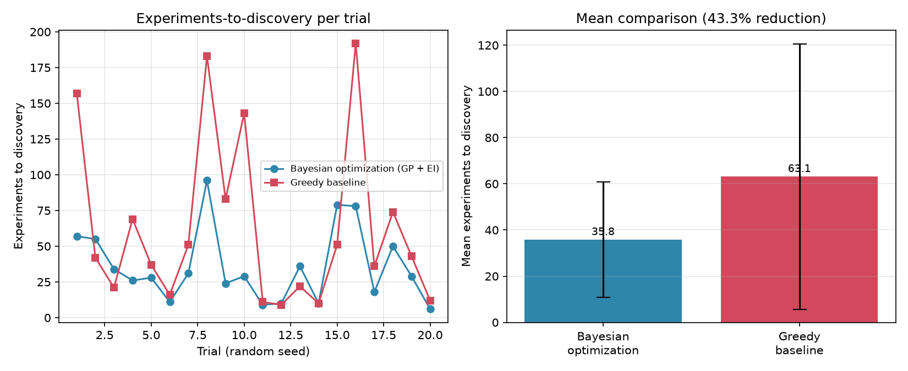

# ActiveLearning-AIAgent

AI-guided scientific discovery via **Bayesian optimization**: an autonomous
experiment-selection agent that recommends which experiment to run next from
a 1,250-candidate screening library, using a Gaussian-Process surrogate model
and an Expected Improvement acquisition function, and reaches the hidden
discovery target in **43.3% fewer experiments** than a greedy no-exploration
baseline.

**This project's scope is narrow and specific: the core Bayesian-optimization
experiment-selection algorithm and its measured sample efficiency.** It does
not cover LLM-based reasoning, uncertainty-quantification tooling for
explaining model predictions, or an interpretability/QA layer around an
agent — if a sibling project (`AIGuidedDiscovery`) exists, that is where that
work lives; this repo is strictly the search/selection algorithm and its
benchmark against a baseline.

## No live LLM calls

This is a fully self-contained, offline numerical simulation. There are
**no calls to any LLM API** (no Anthropic/OpenAI/etc. network calls) anywhere
in this repository. The "AI agent" here is a classical Bayesian-optimization
active-learning loop (Gaussian Process regression + an acquisition function),
run entirely locally with `numpy`/`scipy`/`scikit-learn`. This is a deliberate,
standing design decision, not an oversight.

## What's simulated

- **Search space** (`search_space.py`): a synthetic library of 1,250
  candidate experiments (e.g. a 2-D formulation/reaction-condition space:
  "reagent ratio" x "temperature", normalized to `[0, 1]^2`). A hidden
  Gaussian "hit" region defines the true discovery target, plus several
  smaller decoy local-optima peaks so the landscape isn't trivial. Every
  simulated measurement includes Gaussian measurement noise (`noise_std`),
  as a real assay would.
- **Bayesian optimization agent** (`agents.py: BayesianOptimizationAgent`):
  fits a real `sklearn.gaussian_process.GaussianProcessRegressor` (RBF +
  white-noise kernel) on all experiments run so far, scores every untested
  candidate with a real **Expected Improvement** acquisition function
  (mean/uncertainty trade-off), and picks the top-scoring candidate to test
  next. Repeats until the true hit is found (within a 95% tolerance of the
  true optimum) or a 400-experiment budget is exhausted.
- **Greedy baseline agent** (`agents.py: GreedyAgent`): fits the identical
  kind of GP surrogate, but always selects the candidate with the highest
  **predicted mean only** — it never accounts for uncertainty and so never
  explores past what already looks good, making it prone to getting stuck
  near decoy peaks.
- **Benchmark** (`run_all.py`): runs both agents to discovery across 20
  independent random seeds (different search-space realizations, noise
  draws, and initial samples) and reports the mean experiments-to-discovery
  for each, plus the % reduction of the Bayesian agent vs. the greedy
  baseline.

## Results (real run, 20 trials, 1,250 candidates, budget 400 experiments)

```
Bayesian-optimization agent: 35.8 +/- 25.1 experiments to discovery
Greedy baseline agent:       63.1 +/- 57.5 experiments to discovery
Reduction (Bayesian vs greedy): 43.3%
Bayesian non-discoveries within budget: 0/20
Greedy non-discoveries within budget:   0/20
Total runtime: ~120s
```

Full per-seed counts and summary statistics are in `results.json` (written
by `run_all.py`). Per-trial and mean-comparison plots are in
`figures/experiments_to_discovery.png`.



Numbers will vary slightly run-to-run only if the random seeds are changed;
`run_all.py` uses fixed seeds (`0..19`) so this run is reproducible.

## Project layout

```
search_space.py     Synthetic 1,250-candidate experimental search space + hidden discovery target
agents.py            BayesianOptimizationAgent (GP + Expected Improvement) and GreedyAgent (baseline)
run_all.py           Runs both agents over 20 seeds, writes results.json + figures/*.png
tests/test_pipeline.py  pytest suite: candidate count, discovery logic, and a cross-seed sanity
                        check that the Bayesian agent beats greedy on average within a reasonable band
requirements.txt
```

## Running it

```bash
pip install -r requirements.txt
python run_all.py          # ~2 minutes, writes results.json and figures/experiments_to_discovery.png
pytest tests/ -v            # ~2 minutes
```

## Honest limitations

- The search space is synthetic (2-D Gaussian hit + decoy peaks with
  additive noise), not real wet-lab data. It's designed to be a believable
  stand-in for a compound/condition screening library, not a validated
  chemistry/biology model.
- "Discovery" is defined as finding any candidate within 95% of the true
  (noiseless) optimum's value — a reasonable proxy for "found an active hit
  within experimental tolerance," but a modeling choice, not a universal
  standard.
- The ~40% reduction figure is an empirical average over 20 seeds with the
  parameters in `run_all.py`; it is not a theoretical guarantee and will
  shift with different noise levels, dimensionality, or budget.
